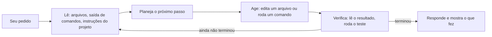

# 01. O que é o Claude Code

## Um agente, não um chat

Num chat, você pergunta e copia a resposta. Num **agente de código**, você pede um resultado, e ele trabalha para chegar lá: lê os arquivos do projeto, roda comandos, edita o que precisa e confere se funcionou. O Claude Code é o agente de código da Anthropic. Ele roda na sua máquina, dentro da pasta do seu projeto, com as **ferramentas** que você deixar: ler arquivo, editar arquivo, rodar comando no terminal, buscar na web.

Para quem é de infra, a comparação útil é esta: o chat é como pedir uma sugestão a um colega; o agente é como passar a tarefa para ele, com acesso ao seu terminal, e acompanhar o que ele faz.

## O loop do agente

Todo pedido segue o mesmo ciclo, que se repete até a tarefa terminar:



Duas consequências práticas:

- **O agente erra e corrige sozinho**, desde que consiga verificar. Por isso pedir "rode os testes" ou "confira o resultado" melhora muito a qualidade.
- **Cada volta do loop gasta tokens.** Tarefa vaga gera voltas desnecessárias. Pedido claro, com o critério de "pronto", economiza.

## As superfícies

O Claude Code é o mesmo agente em vários lugares. Cada lugar é uma **superfície**:

| Superfície | Como abrir | Quando usar |
|---|---|---|
| Terminal | `claude` na pasta do projeto | A mais completa: tudo funciona aqui, inclusive `/config` e os atalhos |
| Extensão do VS Code | Painel do Claude Code no VS Code | Ver os diffs no editor. No workshop, preferimos o `claude` no **terminal integrado** do VS Code, porque a extensão não tem o `!` |
| App desktop | `claude --desktop` ou o app instalado | Várias sessões lado a lado, sem terminal |
| Web | claude.ai/code | Tarefa que roda na nuvem, sem a sua máquina ligada |
| Celular | App Claude, aba Code, ou o Remote Control | Acompanhar e responder a uma sessão de longe |

Documentação: https://code.claude.com/docs/en/desktop, https://code.claude.com/docs/en/claude-code-on-the-web, https://code.claude.com/docs/en/remote-control.

## Quem tem acesso

O Claude Code exige um plano pago: **Pro, Max, Team ou Enterprise**, ou uma conta Console com créditos. **O plano Free não dá acesso.** Algumas features dependem do login no claude.ai, e não funcionam só com chave de API: o Remote Control e as sessões na nuvem, por exemplo.

## Exemplo: instalar e conferir

No Windows (PowerShell):

```powershell
irm https://claude.ai/install.ps1 | iex
claude --version
```

No macOS, Linux ou WSL:

```bash
curl -fsSL https://claude.ai/install.sh | bash
claude --version
```

Se algo der errado, `claude doctor` mostra o diagnóstico. No Windows, instale o Git antes: ele traz o Git Bash, que o Claude Code usa para rodar comandos. O passo a passo completo, com Git, PowerShell 7, Azure CLI e o teste final, está no [checklist pré-workshop](../checklist-pre-workshop.md).

Para começar, entre na pasta do projeto e rode `claude`. Na primeira vez, o navegador abre para o login, e o Claude Code pergunta se você confia na pasta.

## Quando usar

- **Use** para tarefas com começo, meio e fim: escrever um script, investigar um erro, revisar uma configuração, documentar um ambiente.
- **Use com cuidado redobrado** quando o agente tocar em ambiente real: nuvem, banco, produção. As partes 03 e 05 mostram como controlar e frear o que ele faz.
- **Não use como oráculo:** o agente pode inventar um comando que não existe. Peça a fonte oficial (parte 05 mostra o MCP do Microsoft Learn) e verifique.

## Para ir além

- Instalação: https://code.claude.com/docs/en/setup
- Primeiros passos: https://code.claude.com/docs/en/quickstart
