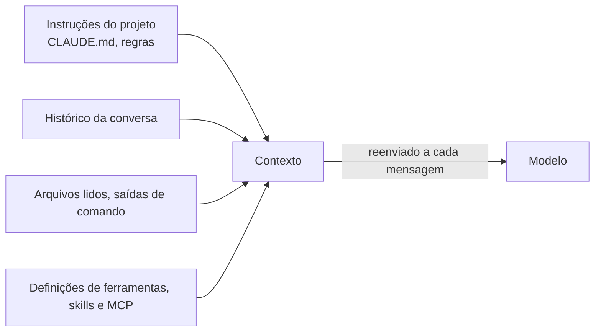

# 02. Sessão, contexto e custo

## Os quatro gestos de uma sessão

Uma sessão é uma conversa com o agente, aberta com `claude` na pasta do projeto. Quatro gestos resolvem quase tudo:

| Gesto | Como | O que faz |
|---|---|---|
| Pedir | Texto normal | O Claude decide o que ler e o que fazer |
| Apontar | `@arquivo` ou `@pasta/` | Põe o conteúdo direto na conversa, sem o Claude precisar procurar. Tab completa o nome |
| Rodar | `!comando` | Roda o comando direto, sem passar pelo Claude, e põe a saída na conversa |
| Mostrar | Print + **Alt+V** (Windows) ou **Ctrl+V** (macOS) | Cola uma imagem, como o print de um erro |

> **No Windows, o `!` roda no Git Bash**, não no PowerShell. `!git status` e `!ls` funcionam; `!Get-ChildItem` dá erro.

Para trocar de assunto, use `/clear`: ele começa uma conversa nova, com o contexto vazio. `/resume` reabre uma conversa anterior. Com o campo vazio, `?` mostra os atalhos.

## Contexto e tokens

Três palavras explicam o custo:

- **Token:** o pedaço de texto que o modelo lê e escreve. O plano e a API medem o uso em tokens.
- **Contexto:** tudo o que o Claude está "vendo": suas mensagens, as respostas, os arquivos lidos e as instruções do projeto. **Cada mensagem nova reenvia o contexto inteiro.** Por isso conversa longa gasta mais a cada mensagem.
- **Effort:** quanto o modelo pensa antes de responder. Effort baixo é mais rápido e gasta menos; effort alto pensa mais, confere mais e gasta mais.



Três comandos mostram e controlam o contexto:

| Comando | O que faz |
|---|---|
| `/context` | Mostra uma grade com o que ocupa o contexto e o total de tokens |
| `/compact` | Troca a conversa por um resumo dela. Mantém o fio, mas gasta para resumir. Aceita uma instrução: `/compact mantenha só a causa do erro e o comando que resolveu` |
| `/clear` | Começa do zero. Não custa nada |

O Claude Code compacta sozinho quando o contexto está quase cheio.

## Modelos e effort

- `/model` lista os modelos (`opus`, `sonnet`, `haiku`). `/model haiku` troca para o menor e mais rápido.
- `/effort low`, `/effort high` e `/effort status` ajustam e mostram o effort.
- A palavra `ultrathink` numa mensagem pede um raciocínio mais profundo só naquela mensagem.

> **`/model` e `/effort` digitados ficam salvos** para as próximas sessões, e o effort fica salvo por modelo. Para voltar ao padrão: `/effort auto` e `/model default`. Para mudar só na sessão atual, abra o `/model`, escolha com as setas e aperte **s**.

**Regra prática:** comece com o padrão. Suba o effort quando errar custa caro, como corrigir um script de produção. Desça o effort, ou use um modelo menor, em perguntas rápidas que você mesmo vai revisar.

## Quanto custa

`/usage` (ou `/cost`) mostra os tokens da sessão por modelo e um **custo estimado em dólar**. Esse valor é o que a conversa custaria na API, a preço de tabela. **No plano de assinatura, você não paga esse valor:** o que conta são as barras de uso do plano, que aparecem na mesma tela. Quando o limite acaba (`Usage limit reached`), o Claude Code espera o limite renovar.

O **fast mode** (`/fast`) deixa o Opus até 2,5 vezes mais rápido, com a mesma qualidade, mas cobra mais por token. Nos planos de assinatura, ele só funciona com créditos extras e gasta deles mesmo que ainda sobre limite no plano. O atalho **Alt+O** liga e desliga: cuidado.

## Exemplo: investigar um deploy que falhou

Imagine um repositório de automação com um script de deploy e o log da última execução, que falhou. Numa sessão nova:

```text
/clear
Leia @logs/deploy.log e @scripts/deploy-webapp.ps1. Em até 6 linhas, diga por que o deploy falhou e em qual linha do script está a causa. Não altere nenhum arquivo.
!git log --oneline -5
```

O `@` põe os dois arquivos direto na conversa; o `!` mostra os últimos commits, e o Claude comenta se alguma mudança recente explica o erro. Se você tiver um print do erro no portal, cole com Alt+V.

Para comparar o custo, repita o mesmo pedido em duas combinações, sempre com `/clear` antes, e olhe `/context` e `/usage` depois de cada uma:

```text
/model haiku
/effort low
```

```text
/model opus
/effort high
```

Compare tempo, tokens e qualidade da resposta. No fim, volte ao padrão com `/effort auto` e `/model default`.

## Quando usar

- **`/clear`** sempre que trocar de assunto. É o hábito que mais economiza.
- **`/compact`** quando a conversa é longa, mas o fio importa.
- **Modelo menor** para tarefas mecânicas; **effort alto** para decisões caras.
- **`/context`** quando o Claude parecer "esquecido" ou lento: talvez o contexto esteja cheio de coisa velha.

## Leia mais

- Para praticar depois (opcional): as fichas [01](../exercicios/01-primeira-sessao.md) e [02](../exercicios/02-modelo-effort-tokens.md)
- Modo interativo e atalhos: https://code.claude.com/docs/en/interactive-mode
- Comandos: https://code.claude.com/docs/en/commands
- Modelos e effort: https://code.claude.com/docs/en/model-config
- Fast mode: https://code.claude.com/docs/en/fast-mode
