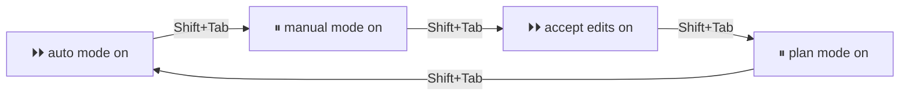

# 03. Permissões, plan mode e rewind

## Quanto o Claude faz sozinho

O **modo de permissão** decide o que o Claude pode fazer sem pedir a sua aprovação. O modo atual aparece **sempre embaixo do campo de digitar**, e **Shift+Tab** passa para o próximo:



| Na tela | Nome técnico | O que o Claude faz sem perguntar |
|---|---|---|
| `⏸ manual mode on` | `default` (a linha de comando também aceita `manual`) | Só lê. Pergunta antes de editar e antes da maioria dos comandos |
| `⏵⏵ accept edits on` | `acceptEdits` | Lê, edita arquivos da pasta e roda comandos simples de arquivo (`mkdir`, `mv`, `cp`, até `rm`). Pergunta antes dos outros |
| `⏸ plan mode on` | `plan` | Lê e pesquisa, mas não edita. Termina com um plano para você aprovar |
| `⏵⏵ auto mode on` | `auto` | Faz tudo sem perguntar. Um segundo modelo, o **classificador**, revisa as ações e bloqueia o que foge do seu pedido |

Desde a versão 2.1.283, na configuração padrão, o Claude Code abre no **auto mode** no terminal e no VS Code. O auto mode diminui as perguntas, mas **não é uma garantia de segurança**: o Claude pode editar sem você ver antes. Quando quiser revisar tudo, passe para o manual mode. No Windows, se o Shift+Tab não funcionar, tente **Alt+M**.

Existe também o `bypassPermissions`, que não pergunta nada e não tem classificador. A documentação recomenda usá-lo só em container ou VM isolados.

## Regras: o que sempre pode, o que sempre pergunta e o que nunca

O modo vale para tudo. As **regras de permissão** decidem caso a caso: uma lista do que roda sem perguntar (`allow`), do que sempre pergunta (`ask`) e do que nunca roda (`deny`). Elas ficam na chave `permissions` de um `settings.json`:

```json
{
  "permissions": {
    "allow": ["PowerShell(az account show)", "PowerShell(Invoke-Pester *)"],
    "ask": ["PowerShell(git push *)"],
    "deny": ["Read(./.env)", "Read(**/*.pfx)"]
  }
}
```

Esse exemplo deixa o `az account show` e o `Invoke-Pester` rodarem sem pergunta, sempre pergunta antes de um `git push` e proíbe o Claude de ler o `.env` e os certificados `.pfx`. A ordem de avaliação é **deny, depois ask, depois allow**, e vale a primeira que casar: se um `deny` casa, nada mais importa. O `deny` e o `ask` valem em qualquer modo, inclusive no auto mode e no `bypassPermissions`.

> **No Windows, use `PowerShell(...)`.** O Claude roda os comandos pela ferramenta PowerShell, e uma regra `Bash(...)` não pega esses comandos. Pior: no Windows com Git Bash, uma regra `deny` de `Bash(...)` **desliga a ferramenta PowerShell** da sessão, sem aviso. No macOS e no Linux, use `Bash(...)`, com a mesma sintaxe. Comandos só de leitura, como `git status` e `ls`, já rodam sem perguntar em qualquer modo.

**Pelo próprio Claude:** `/permissions` mostra as regras ativas e de qual arquivo cada uma veio, e deixa você acrescentar ou remover uma regra sem abrir o JSON. Quando o Claude pergunta antes de um comando e você responde "sim, e não pergunte de novo", ele grava uma regra `allow` no `.claude/settings.local.json`. A aprovação de uma edição de arquivo não é gravada: vale só até o fim da sessão.

**Onde a regra mora** decide para quem ela vale:

| Arquivo | Vale para | Vai para o git? |
|---|---|---|
| `~/.claude/settings.json` | Você, em todos os projetos | Não |
| `.claude/settings.json` | Toda a equipe, neste projeto | Sim |
| `.claude/settings.local.json` | Só você, neste projeto | Não. Quando o Claude Code cria o arquivo, ele o esconde do git; se você criar à mão, ponha no `.gitignore` |
| Configuração gerenciada | Todos da organização; ninguém sobrescreve | Não, a TI distribui |

As listas de regras **se somam** entre os arquivos, e um `deny` de qualquer arquivo vence um `allow` de qualquer outro: um `deny` no seu `~/.claude/settings.json` barra até um `allow` do projeto. Para um valor simples, como o modo inicial, vence o arquivo mais forte: a configuração gerenciada, depois a linha de comando (`--settings`), depois o `settings.local.json`, depois o `settings.json` do projeto e, por último, o seu `~/.claude/settings.json`.

> **Regra não é muro.** A regra olha a chamada de ferramenta, não o que acontece depois dela. Num teste com a versão 2.1.296, a regra `deny` em `Read(./.env)` barrou a leitura pela ferramenta de arquivo e até um `Get-Content .env` no terminal, mas **não** barrou um script `.ps1` que lê o `.env` por dentro. Para o que **nunca** pode acontecer, combine três proteções: a identidade com o mínimo de permissão, a regra `deny` e um hook (parte 05).

## Plan mode: pensar antes de mexer

No plan mode, o Claude investiga e escreve um plano, sem editar nada. No fim, você escolhe:

- **Yes, and use auto mode:** aprova e passa para o auto mode;
- **Yes, manually approve edits:** aprova e pede a sua aprovação em cada edição;
- **No, keep planning:** continua planejando, com o ajuste que você pedir.

Atalhos úteis: `/plan <tarefa>` entra no plan mode já com o pedido; `claude --permission-mode plan` abre o Claude direto no plan mode; **Ctrl+G** abre o plano no editor para você mudar o texto antes de aprovar.

Quando o Claude propõe uma edição, ele mostra o diff. Para recusar e explicar o motivo, vá até **No**, aperte **Tab** e escreva o comentário: o Claude recebe o motivo e continua. Recusar com **Esc** para a vez dele.

## Rewind: desfazer

O Claude cria **checkpoints** enquanto edita. Com o campo de digitar **vazio**, **Esc Esc** (ou `/rewind`) abre a lista das suas mensagens. Escolha uma e decida o que voltar:

- **Restore code:** volta os arquivos para antes daquela mensagem e mantém a conversa;
- **Restore code and conversation** volta os dois, e **Restore conversation** volta só a conversa;
- **Summarize from here** e **Summarize up to here** trocam parte da conversa por um resumo, para liberar contexto.

As opções de código só aparecem quando aquele ponto tem edições de arquivo.

> **O que não volta:** o rewind só desfaz o que o Claude mudou com as ferramentas de edição de arquivo. O que ele fez **rodando um comando no terminal** fica: criar, copiar, mover ou apagar arquivo com `cp`, `mv`, `rm`, `Copy-Item`, `Move-Item` ou `Remove-Item`. O rewind também não substitui o Git: para guardar versões de verdade, faça commit.

## Exemplo: planejar, ajustar, aprovar e desfazer

Imagine um script de limpeza de logs antigos, que roda no servidor de arquivos e tem o prazo de 30 dias fixo no código:

```text
(Shift+Tab até "plan mode on")
Planeje duas mudanças em @scripts/limpa-logs.ps1: trocar o 30 fixo por um parâmetro -Dias e acrescentar um modo -WhatIf que só lista o que seria apagado.
(escolha "No, keep planning" e peça: "registre num log o nome de cada arquivo apagado")
(depois escolha "Yes, manually approve edits" e aprove cada edição olhando o diff)
!git diff --stat
(campo vazio, Esc Esc, escolha a mensagem do plano, Restore code)
!git status
```

Repare: num script que **apaga** arquivos, o plan mode e a aprovação manual valem o tempo extra. E se o Claude tivesse rodado o script para testar, os arquivos apagados **não voltariam** com o rewind.

## Quando usar

| Situação | Modo |
|---|---|
| Explorar um projeto novo ou entender um erro | plan ou manual |
| Mudança grande, ou em arquivo sensível | plan primeiro, depois manual |
| Tarefa rotineira num projeto com Git e testes | auto ou accept edits |
| Qualquer coisa que toque em ambiente real (nuvem, banco) | manual, e um hook que barre o perigoso (parte 05) |
| Um arquivo ou comando que o Claude nunca deve tocar, em nenhum modo | Uma regra `deny` no `settings.json` |
| Um comando seguro que você aprova toda hora | Uma regra `allow`, ou "sim, e não pergunte de novo" |

Hábito que salva: comece com `git status` limpo. Assim, o Git mostra exatamente o que o Claude mudou, e `git restore` desfaz até o que o rewind não alcança.

## Leia mais

- Para praticar depois (opcional): a ficha [03](../exercicios/03-permissoes-plan-mode-rewind.md)
- Modos de permissão: https://code.claude.com/docs/en/permission-modes
- Regras de permissão: https://code.claude.com/docs/en/permissions
- Checkpoints e rewind: https://code.claude.com/docs/en/checkpointing
