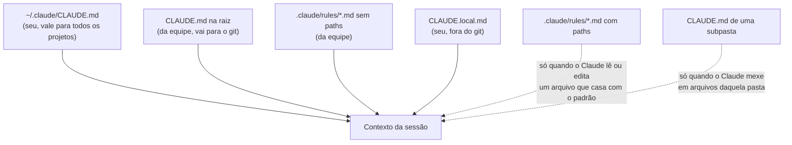

# 04. Memória e instruções

## Por que o Claude precisa de instruções

Toda sessão começa sem memória da anterior. O que faz o Claude "conhecer" o seu projeto são os **arquivos de instrução**: textos que o Claude Code carrega no contexto no começo da sessão, ou quando o trabalho toca numa pasta específica. É ali que vão as regras que o código não diz sozinho: como rodar os testes, o que nunca fazer, o vocabulário do domínio.

Esses arquivos são **pedidos**, não impedimentos. O Claude costuma seguir, mas nada o obriga. Para impedir de verdade, use um hook (parte 05).

## Os arquivos e quando cada um carrega



| Arquivo | Quem escreve | Vai para o git? | Quando carrega |
|---|---|---|---|
| `~/.claude/CLAUDE.md` | Você | Não | Em toda sessão, em qualquer projeto |
| `CLAUDE.md` (ou `.claude/CLAUDE.md`) | A equipe | Sim | No começo de toda sessão |
| `.claude/rules/x.md` sem `paths` | A equipe | Sim | No começo de toda sessão |
| `.claude/rules/x.md` com `paths` | A equipe | Sim | Só quando o Claude lê ou edita um arquivo que casa com o padrão |
| `CLAUDE.local.md` | Você | Não (ponha no `.gitignore`) | No começo de toda sessão, depois do `CLAUDE.md` |
| `CLAUDE.md` de subpasta | A equipe | Sim | Quando o Claude mexe em arquivos daquela pasta |

O Claude Code também carrega os `CLAUDE.md` das **pastas acima** da atual. Por isso vale clonar cada projeto numa pasta própria.

Uma regra com `paths` tem um cabeçalho assim:

```markdown
---
paths:
  - "terraform/**/*.tf"
---

# Convenções de Terraform

- Todo recurso tem as tags CostCenter, Owner e Environment.
- Nunca rode terraform apply; mostre o plan e pare.
```

Essa regra só entra no contexto quando o Claude lê ou edita um arquivo `.tf` da pasta `terraform/`. Numa conversa sobre os scripts de backup, ela não gasta nada.

## E o AGENTS.md?

`AGENTS.md` é o padrão aberto lido por vários agentes de código. O Claude Code lê o `AGENTS.md` nativamente, mas, no padrão (`claude-md-or-agents-md`), **só quando a pasta não tem `CLAUDE.md`, `.claude/CLAUDE.md` nem `CLAUDE.local.md`**. Para usar um arquivo só para todos os agentes, há dois caminhos:

- pôr `@AGENTS.md` numa linha do `CLAUDE.md` (um **import**). No Windows, prefira isso a um link simbólico;
- mudar a opção **Project instructions** do `/config` para `claude-md-and-agents-md`. Atenção: o `/config` grava isso nas suas configurações de usuário, e a mudança vale para **todos** os seus projetos.

## Comentários que não gastam contexto

Comentários HTML de bloco (`<!-- ... -->`) num `CLAUDE.md` são removidos antes de o arquivo entrar no contexto. Use-os para notas para humanos, sem pagar tokens por elas.

## Memória automática

Além do que você escreve, o Claude pode anotar sozinho o que aprende, como as suas preferências e as correções que você fez: é a **memória automática**. As primeiras 200 linhas (ou 25 KB) do índice dela entram em toda sessão. O `/memory` mostra os arquivos de memória, liga e desliga a memória automática e abre a pasta das notas.

## Exemplo: conferir e personalizar

```text
/context
```

Na lista **Memory files**, veja o que carregou. Depois crie as suas preferências, só suas:

```text
!echo "- Meu nome é Ana. Me chame pelo meu nome nas respostas." > CLAUDE.local.md
!echo "- Quando me mostrar um comando, use a sintaxe do PowerShell 7." >> CLAUDE.local.md
```

Saia com `/exit`, abra de novo com `claude` e rode `/context`: o `CLAUDE.local.md` entrou.

## O que pôr num bom CLAUDE.md

- **Curto.** Ele entra em toda mensagem e custa tokens sempre. Aponte para outros documentos em vez de copiar tudo.
- **O que o código não confessa:** como rodar e testar, o que nunca fazer, as armadilhas conhecidas.
- **Comandos exatos**, prontos para copiar, em vez de descrições vagas.
- **Nada de segredo.** O arquivo vai para o git.

Um exemplo enxuto, para um repositório de infra com Terraform e scripts:

```markdown
# Infra da área de dados

Terraform em `terraform/` (um diretório por ambiente) e scripts PowerShell em `scripts/`.

## Como validar
- Terraform: `terraform fmt -check` e `terraform validate`, depois `terraform plan` no ambiente `dev`.
- Scripts: `Invoke-Pester -Path testes`.

## Regras que o código não diz
- Produção só muda por pipeline. Nunca rode `terraform apply` daqui.
- O ambiente `hml` tem dados reais: trate como produção.
- Segredos ficam no Key Vault; nunca escreva valor de segredo em arquivo.
```

## Quando usar

| Quero... | Use |
|---|---|
| Regra da equipe, para todos | `CLAUDE.md` ou `.claude/rules/` |
| Regra que só vale para um tipo de arquivo | `.claude/rules/` com `paths` |
| Preferência só minha neste projeto | `CLAUDE.local.md` |
| Preferência minha em todos os projetos | `~/.claude/CLAUDE.md` |
| Um arquivo para vários agentes | `AGENTS.md` com `@AGENTS.md` no `CLAUDE.md` |

## Leia mais

- Para praticar depois (opcional): a ficha [04](../exercicios/04-claude-md-e-memoria.md)
- Memória e instruções: https://code.claude.com/docs/en/memory
