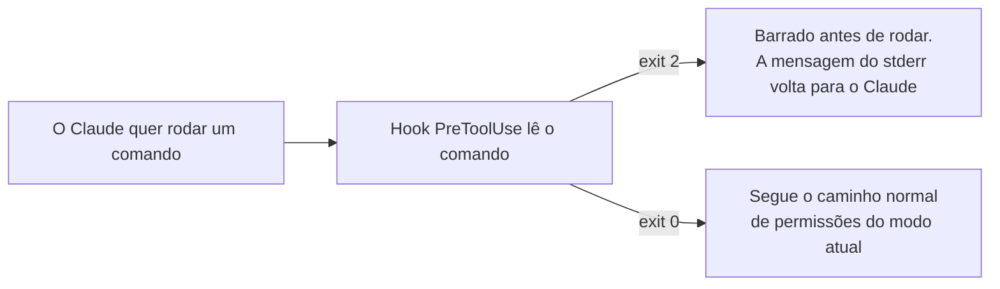

# 05. Skills, plugins, MCP e hooks

Quatro jeitos de estender o Claude Code. Os três primeiros **dão** capacidades novas; o último **controla** o que ele faz.

| Peça | O que é | Em uma frase |
|---|---|---|
| Skill | Um `SKILL.md` com instruções | Ensina o Claude a fazer uma tarefa do seu jeito |
| Plugin | Um pacote de skills, agentes, hooks e servidores MCP | Instala várias peças de uma vez |
| MCP | Um servidor que dá ferramentas novas | Liga o Claude a um sistema de fora |
| Hook | Um comando que o Claude Code roda num momento fixo | Barra, confere ou registra o que o Claude faz |

## Skills

Uma **skill** é uma pasta com um `SKILL.md`: um cabeçalho com `name` e `description` e, depois, as instruções. O Claude usa a skill quando a tarefa pede, pela descrição, ou quando você chama pelo nome, como `/gerar-runbook`. **Só o nome e a descrição ficam no contexto o tempo todo**; o corpo só entra quando a skill roda.

```markdown
---
name: gerar-runbook
description: Gera um runbook de troubleshooting em markdown para um serviço Azure. Use quando pedirem um runbook ou um passo a passo de diagnóstico.
---

Escreva um runbook de troubleshooting em markdown para este serviço Azure: $ARGUMENTS
Use as seções: sintomas, primeiras verificações, causas comuns, correção e quando escalar.
Não execute nenhum comando.
```

O Claude Code troca `$ARGUMENTS` pelo texto que você digita depois do comando. As skills do projeto ficam em `.claude/skills/<nome>/SKILL.md`, e as suas, para todos os projetos, em `~/.claude/skills/`. Se a pasta for criada no meio da sessão, rode `/reload-skills`. `/skills` lista as skills, e a tecla `t` ordena por tokens.

## Plugins e marketplaces

Um **plugin** instala de uma vez skills, agentes, hooks e servidores MCP. Ele vem de um **marketplace**. O oficial da Anthropic, `claude-plugins-official`, já vem configurado.

```text
/plugin
/plugin install mattpocock-skills@claude-plugins-official
```

O `/plugin install` não instala na hora: ele mostra os detalhes, inclusive o **Context cost**, ou seja, quanto o plugin soma a toda mensagem (**Every turn**) e quanto soma quando roda (**When invoked**). No terminal, fora do Claude, `claude plugin details mattpocock-skills` mostra o mesmo, componente por componente. **Todo plugin ligado custa tokens em toda mensagem, mesmo sem usar.** Olhe o custo antes de instalar.

Skill de plugin se chama com o nome do plugin na frente: `/mattpocock-skills:grill-me`.

> **Segurança:** plugins e hooks rodam com as **suas** permissões. A Anthropic não revisa marketplaces de terceiros. Instale só da fonte oficial de cada projeto.

## MCP

Um **servidor MCP** dá ao Claude ferramentas novas, que falam com um sistema de fora: uma documentação, um banco, uma nuvem.

```powershell
claude mcp add --transport http microsoft-learn https://learn.microsoft.com/api/mcp
claude mcp list
```

Dentro do Claude, `/mcp` mostra os servidores e as ferramentas de cada um. O MCP do Microsoft Learn não pede login e busca na documentação oficial da Microsoft. É ótimo para pedir comandos `az` **com fonte**, em vez de confiar na memória do modelo.

O **Azure MCP** consulta os recursos da sua subscription. Ele precisa de Node.js 22 ou mais novo e usa o seu `az login`. **Ligue-o sempre com `--read-only`**, que esconde as ferramentas que criam, alteram ou apagam:

```powershell
claude mcp add --transport stdio azure-mcp -- npx -y @azure/mcp@latest server start --read-only
claude mcp get azure-mcp
```

A linha `Args:` do `claude mcp get` precisa terminar com `--read-only`. Não use o plugin `azure` do marketplace para isso: ele liga o mesmo servidor **sem** `--read-only`.

## Hooks

Um **hook** é um comando que o próprio Claude Code roda num momento fixo da sessão: no começo da sessão (`SessionStart`), a cada mensagem sua (`UserPromptSubmit`), antes ou depois de uma ferramenta (`PreToolUse`, `PostToolUse`), no fim do turno (`Stop`), entre outros. Ele é configurado na chave `hooks` do `settings.json`, e `/hooks` mostra os hooks ativos.

O mais poderoso é o `PreToolUse`: ele roda **antes** de cada chamada de ferramenta, inclusive antes da pergunta de permissão, e recebe no stdin um JSON com o nome da ferramenta e o comando.



Um exemplo clássico para infra é um **freio de escrita no Azure**: o hook lê o comando e, se for escrita (`az group delete`, `az vm stop`, `New-Az*`, `terraform apply`...), sai com **exit 2**, e o comando nem roda. Leitura (`show`, `list`, `az graph query`) sai com exit 0. A mesma ideia vale para `kubectl delete` ou `DROP TABLE`. Atenção a dois detalhes:

- **Só o exit 2 barra.** Com exit 1, o Claude Code trata como erro do hook e deixa o comando seguir.
- **No Windows, o Claude costuma usar a ferramenta `PowerShell`.** Um hook com `matcher` só em `Bash` nunca dispararia ali. O freio usa `Bash|PowerShell|Monitor`.

O registro, na forma exec, que é igual no Windows e no macOS:

```json
{
  "hooks": {
    "PreToolUse": [
      {
        "matcher": "Bash|PowerShell|Monitor",
        "hooks": [
          { "type": "command", "command": "pwsh",
            "args": ["-NoProfile", "-NonInteractive", "-ExecutionPolicy", "Bypass", "-File",
                     "${CLAUDE_PROJECT_DIR}/.claude/hooks/freio.ps1"],
            "timeout": 30 }
        ]
      }
    ]
  }
}
```

O freio é a **segunda proteção**. A primeira é a permissão: uma conta só com o papel **Reader** não consegue escrever, mesmo que um comando escape. O freio também não vê tudo: ele lê só a linha de comando, não o que um script chama por dentro, nem o Azure MCP, nem o que você roda no seu terminal.

## Quando usar

| Quero... | Use |
|---|---|
| Repetir um jeito de fazer uma tarefa | Uma skill |
| Ganhar um conjunto pronto de skills e ferramentas | Um plugin (olhe o custo antes) |
| Que o Claude consulte um sistema de fora | Um servidor MCP |
| **Garantir** que algo nunca aconteça | Um hook `PreToolUse` com exit 2 |
| Que algo aconteça sempre, como um teste no fim do turno | Um hook (`Stop`, `PostToolUse`) |

Lembre: instrução no `CLAUDE.md` é um **pedido**; hook é um **impedimento**.

## Leia mais

- Para praticar depois (opcional): as fichas [05](../exercicios/05-plugins-e-skills.md) e [06](../exercicios/06-mcps.md)
- Skills: https://code.claude.com/docs/en/skills
- Plugins: https://code.claude.com/docs/en/discover-plugins
- MCP: https://code.claude.com/docs/en/mcp
- Hooks: https://code.claude.com/docs/en/hooks e https://code.claude.com/docs/en/hooks-guide
