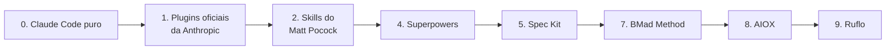
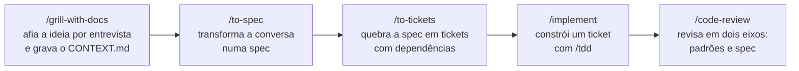

# 06. Formato de trabalho

Saber usar as features não basta. A pergunta seguinte é: **como organizar o trabalho com o agente**, num projeto que dura semanas? Esta parte compara os caminhos que existem e mostra o formato que o instrutor usa nos projetos dele.

## Peças soltas → receita pronta

A pergunta que organiza o mercado é: **quem decide o processo, você ou o framework?**

| Posição | Item | Leitura |
|---|---|---|
| 0 | Claude Code puro | `CLAUDE.md`, plan mode, subagentes, skills suas |
| 1 | Plugins e skills oficiais da Anthropic | Peças avulsas, confiáveis |
| 2 | Skills do Matt Pocock | Peças compostas com fluxos sugeridos; você no controle |
| 4 | Superpowers | Peças compostas com um processo que se ativa sozinho |
| 5 | Spec Kit | Spec-driven: um artefato por etapa (spec, plano, tarefas) |
| 7 | BMad Method | Personas e um processo ágil completo |
| 8 | AIOX | Derivado do BMad, com squads, CLI e hooks |
| 9 | Ruflo | Plataforma de orquestração de muitos agentes |

Quanto mais à direita, mais arquivos, mais contexto consumido, maior a curva de aprendizado e maior o lock-in. A regra prática: **comece pela esquerda e só ande para a direita quando sentir uma dor concreta**, como desalinhamento, falta de testes ou perda de contexto entre sessões. **Não empilhe frameworks:** instruções, hooks e skills duplicadas entram em conflito. Para medir o peso de um plugin antes de decidir, use `claude plugin details <nome>` (parte 05). Estrelas e versões de cada projeto mudam rápido; confira no GitHub.

## AIOX × formato enxuto

O instrutor usou um framework de personas (o AIOX) e depois migrou para um formato com peças soltas, o **formato enxuto**. As cópias reais, sem dados sensíveis, estão em [`exemplos/`](../exemplos/).

| | AIOX | Formato enxuto |
|---|---|---|
| Instrução principal | Um `CLAUDE.md` genérico de 356 linhas, gerado pelo framework | Um `CLAUDE.md` curto, só sobre o projeto |
| Quem trabalha | Personas (`@dev`, `@qa`, `@devops`...), cada uma com autoridade própria | O Claude, com a skill certa para cada etapa |
| Unidade de trabalho | A story, com estados e gates | A issue |
| Peso | Mais de 1.200 arquivos de camada | Cerca de 50 arquivos, mais as skills |

Nenhum é "o certo". O framework dá um processo pronto, que ajuda times grandes, mas pesa em contexto e em manutenção. As peças soltas dão controle, mas pedem que você monte o processo.

## O formato enxuto

As peças, como o instrutor usa:

1. **`CLAUDE.md` curto:** o mapa do projeto e as regras que o código não confessa (parte 04).
2. **Glossário e decisões:** um `CONTEXT.md` com o vocabulário do domínio, em que cada termo tem uma definição e uma lista de palavras a evitar, e ADRs em `docs/adr/`, um arquivo por decisão difícil de desfazer. O agente usa as mesmas palavras que você, e ninguém reabre uma decisão sem saber por que ela foi tomada.
3. **A issue como unidade de trabalho:** cada pedido vira uma issue (no GitHub ou num arquivo em `.scratch/`), com o critério de aceite. O trabalho de várias sessões se coordena por ela.
4. **Uma worktree por issue:** cada tarefa numa cópia separada do repositório, numa branch própria. Várias sessões trabalham ao mesmo tempo sem pisar uma na outra.
5. **O processo mora no repositório:** um documento por processo, com os passos e o "pronto quando". A próxima sessão, ou a próxima pessoa, lê em vez de perguntar.

## O fluxo das skills do Matt Pocock

As skills do Matt Pocock (`mattpocock-skills`, no marketplace oficial) desenham um caminho da ideia até o código entregue:

- **`grill-with-docs`:** o Claude te entrevista em rodadas, com uma resposta recomendada para cada pergunta, até não sobrar decisão no ar. No caminho, grava o glossário.
- **`to-spec` e `to-tickets`:** o que foi decidido vira uma spec, e a spec vira tickets pequenos, cada um dizendo de quais outros depende. Os tickets sem dependência entre si podem andar **em paralelo**.
- **`implement`:** constrói um ticket com TDD (um teste por vez, antes do código) e fecha com a revisão.
- **`code-review`:** dois subagentes em paralelo, um para os padrões do repositório e outro para a spec.

Neste repositório, a configuração que essas skills pedem (onde ficam as issues, o glossário) já está em `docs/agents/`. Num projeto seu, rode `/mattpocock-skills:setup-matt-pocock-skills` uma vez. E use o nome completo, `/mattpocock-skills:code-review`: o Claude Code tem um `/code-review` próprio, que é outra coisa.

## Trabalho em paralelo

| Recurso | Como | Para quê |
|---|---|---|
| Worktree | `claude -w fin-04` | Abre o Claude numa cópia do repositório, em `.claude/worktrees/fin-04/`, numa branch nova |
| Sessão em segundo plano | `claude --bg --name fin-02 "..."` ou o campo de despachar do `claude agents` | Uma tarefa trabalha enquanto você faz outra |
| Agent view | `claude agents` | Um painel com todas as sessões: trabalhando, esperando você, concluídas |
| Remote Control | `/remote-control` (ou `/rc`) | A sessão aparece no app do celular e no claude.ai/code |
| Subagente | Pedir "faça com um subagente" | Uma tarefa num contexto separado, que devolve só o resultado |

Duas armadilhas que o workshop mostrou:

- **A worktree nasce do que está em commit.** Por padrão, ela parte da `main` do remoto; com `"worktree": { "baseRef": "head" }` no `.claude/settings.json`, parte do seu `HEAD` local. Sem commit, a worktree nasce sem o seu trabalho, e sem o hook-freio.
- **Várias sessões gastam o limite do plano mais rápido.** No Pro, prefira duas por vez.

No fim, cada worktree tem uma branch com o seu commit, e você junta tudo na `main` com `git merge`, uma branch de cada vez, rodando os testes entre um merge e outro. Se der conflito, `/mattpocock-skills:resolving-merge-conflicts` ajuda a resolver pela intenção de cada lado.

## Quando usar

- **Projeto pequeno ou tarefa pontual:** Claude Code puro, um bom `CLAUDE.md` e plan mode.
- **Projeto que dura semanas:** o fluxo grill → spec → tickets → implement → review, com glossário e ADRs.
- **Muita coisa ao mesmo tempo:** worktrees e sessões em segundo plano, com cada ticket na sua cópia.
- **Time grande que quer um processo pronto:** avalie um framework mais à direita, medindo o peso antes.

## Pratique e leia mais

- Ficha: [exercício 8](../exercicios/08-implementar-em-paralelo.md)
- Os exemplos lado a lado: [`exemplos/`](../exemplos/)
- Skills do Matt Pocock: https://github.com/mattpocock/skills
- Worktrees: https://code.claude.com/docs/en/worktrees
- Agent view: https://code.claude.com/docs/en/agent-view
- Remote Control: https://code.claude.com/docs/en/remote-control
- Subagentes: https://code.claude.com/docs/en/sub-agents
