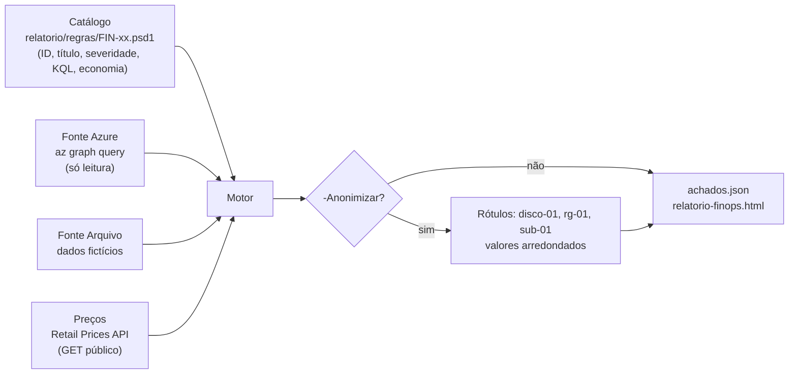

# 07. O projeto da turma: o relatório FinOps

## O problema

Quem cuida de um ambiente Azure grande sabe que existe dinheiro parado nele: discos que ninguém usa, IPs públicos sem nada ligado, VMs desligadas que ainda pagam pelos discos, planos de App Service sem nenhum app, snapshots esquecidos, workspaces guardando dados demais. Achar tudo isso no portal, recurso por recurso, leva horas. E mostrar o resultado na empresa é delicado: o relatório não pode expor nomes nem inventar números.

## A solução

Um **relatório FinOps** em PowerShell 7 que lê uma subscription **só com leitura**, aplica um catálogo de **regras FinOps** e grava a lista de achados (`achados.json`) e uma página HTML que abre direto no navegador.

```powershell
pwsh -File ./relatorio/Invoke-RelatorioFinOps.ps1 -Fonte Azure -SubscriptionId <id-da-subscription>
pwsh -File ./relatorio/Invoke-RelatorioFinOps.ps1 -Fonte Azure -SubscriptionId <id-da-subscription> -Anonimizar -Saida saida/anonimizado
```

## As regras

| Regra | O que procura | Economia |
|---|---|---|
| FIN-01 | Disco que não está ligado a nenhuma VM | Preço de tabela do tier do disco |
| FIN-02 | IP público que não está ligado a nada (o de NAT Gateway fica de fora) | Preço de tabela do IP |
| FIN-03 | VM desligada que continua pagando pelos discos | "Não sei" |
| FIN-04 | Plano do App Service pago e sem nenhum app | Preço de tabela da instância |
| FIN-05 | Snapshot com mais de N dias (`-DiasSnapshot`, padrão 30) | "Não sei" |
| FIN-06 | Log Analytics com retenção longa ou sem limite diário | "Não sei" |
| FIN-07 | Economia que o Azure Advisor já recomenda | O valor do próprio Advisor |
| FIN-08 a FIN-11 (bônus) | Load Balancer e App Gateway vazios, NIC sem VM, recursos sem as tags de custo | "Não sei", com o motivo |

As regras se inspiram em produtos de FinOps, como o azirion, da TFTEC, e são conhecimento público de FinOps no Azure.

## A arquitetura



- **Catálogo:** um arquivo `.psd1` por regra. Para incluir uma regra, basta um arquivo novo, sem mexer no motor.
- **Fontes:** a fonte `Azure` roda a KQL de cada regra com `az graph query`, com escopo na subscription-alvo, 1.000 linhas por página. Ela só chama `az extension show`, `az account show` e `az graph query`. A fonte `Arquivo` lê a resposta que a KQL daria, gravada em `dados-ficticios/`, para testar sem Azure.
- **Economia:** o valor do Advisor, o preço de tabela da Retail Prices API ou "não sei".
- **Saídas:** o `achados.json` e um HTML autocontido, sem nada de fora.

## "Não sei" nunca é zero

Quando não há preço confiável, o relatório mostra **"não sei"**, com o motivo, e não 0 nem um valor chutado. Um "não sei" é um desperdício que existe, mas que o relatório não sabe calcular sem inventar. Exemplos:

- a VM desligada: o custo depende do tier de cada disco, que a KQL não traz;
- o snapshot: ele é cobrado pelo espaço **usado**, que o Resource Graph não informa;
- o disco criado vazio e **nunca anexado**: o Azure ainda não cobra por ele;
- o Advisor em outra moeda: o relatório não converte moeda e mostra o valor original no motivo.

O topo do HTML separa a **economia estimada** (a soma só dos achados com preço) da contagem de achados com "não sei". Lembre também que o preço de tabela não tem desconto de contrato, reserva ou savings plan: a economia real pode ser menor. Antes de levar um número para a empresa, confira o recurso no portal.

## O modo anonimizado

Com `-Anonimizar`, nomes de recursos, de grupos de recursos e da subscription viram rótulos estáveis (`disco-01`, `rg-01`, `sub-01`); IDs, GUIDs e IPs viram `<oculto>`; os valores em reais vão para a dezena, com piso de R$ 10. O HTML mostra o selo **Modo anonimizado**. É essa a versão que vai numa reunião ou numa tela compartilhada.

## O que o ensaio ensinou

O relatório foi testado contra um Azure real antes do workshop. Quatro problemas só apareceram ali, e cada um virou uma regra do projeto:

1. **Booleano da KQL volta como 1 ou 0.** Uma expressão como `nuncaAnexado = ... and isnull(...)` chega do Resource Graph como número, e não como `true`/`false`. A correção: `tobool(...)` na KQL, e o motor aceita os dois formatos.
2. **O `az.cmd` corta na quebra de linha.** No Windows, o `az` é um `az.cmd`, e o `cmd.exe` corta o argumento na primeira quebra de linha. Uma KQL de várias linhas chegaria ao Azure cortada, **sem o `--subscriptions`**, e consultaria todas as subscriptions do login. Por isso a KQL vai numa linha só, sem comentário `//`.
3. **O Git Bash converte `/subscriptions/...` em caminho.** No Git Bash do Windows, um argumento que começa com `/` vira caminho de arquivo. A correção: `MSYS_NO_PATHCONV=1`. O relatório roda no PowerShell e não sofre disso.
4. **As APIs respondem 429 (Too Many Requests).** A Retail Prices API e o Cost Management limitam os pedidos. O relatório tenta de novo, esperando um pouco mais a cada vez, antes de desistir e cair para "não sei".

A lição geral: **testes com dados fictícios não pegam tudo**. Rode contra o ambiente real, só com leitura, antes de confiar.

## Continue em casa

- **Compare com o gabarito:** `git switch gabarito` traz a versão completa e testada. O `relatorio/README.md` dela explica cada parâmetro.
- **Regras bônus:** o ticket 07 em `.scratch/relatorio-finops/issues/`.
- **Custo real:** com `-CustoReal` e o papel **Cost Management Reader**, o relatório lê o que cada recurso custou nos últimos 30 dias e usa esse valor no lugar do preço de tabela.
- **Uma regra sua:** copie um `.psd1` do catálogo, troque a KQL, ponha a resposta fictícia em `dados-ficticios/` e peça ao Claude os testes. A spec está em `.scratch/relatorio-finops/spec.md`, e o vocabulário em [`CONTEXT.md`](../CONTEXT.md).

## Pratique e leia mais

- Fichas: [exercício 8](../exercicios/08-implementar-em-paralelo.md) e [exercício 9](../exercicios/09-rodar-e-revisar.md)
- Azure Resource Graph no CLI: https://learn.microsoft.com/cli/azure/graph
- Retail Prices API: https://learn.microsoft.com/rest/api/cost-management/retail-prices/azure-retail-prices
